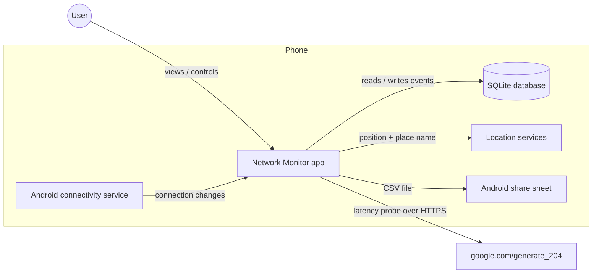
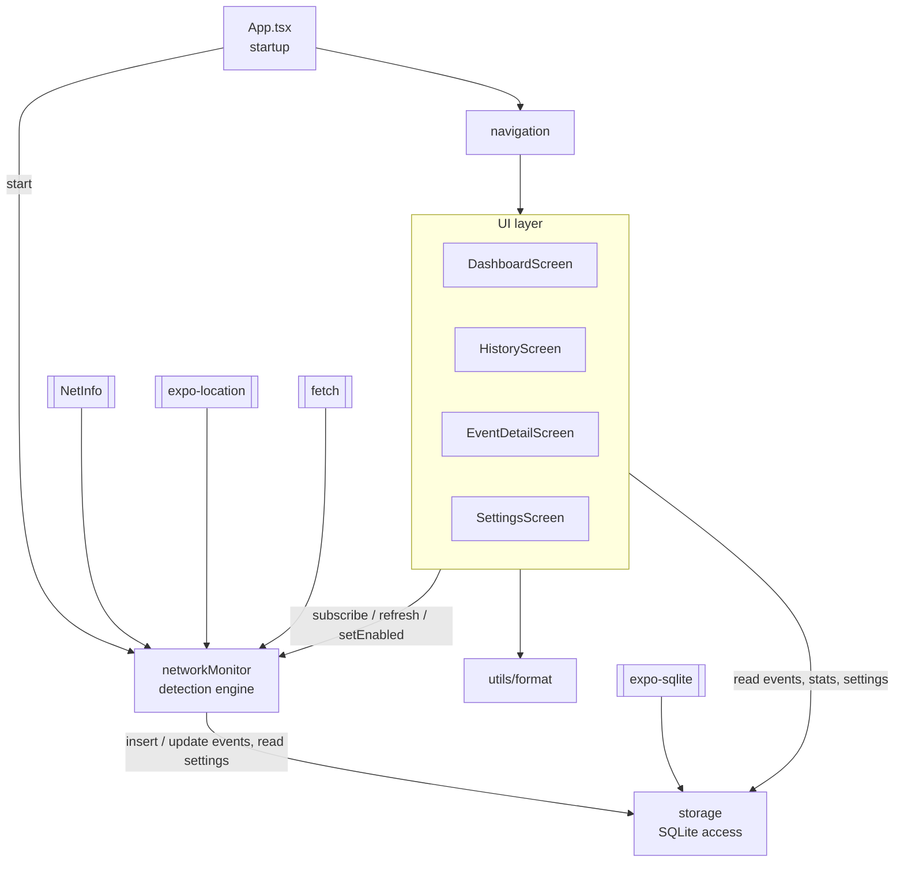
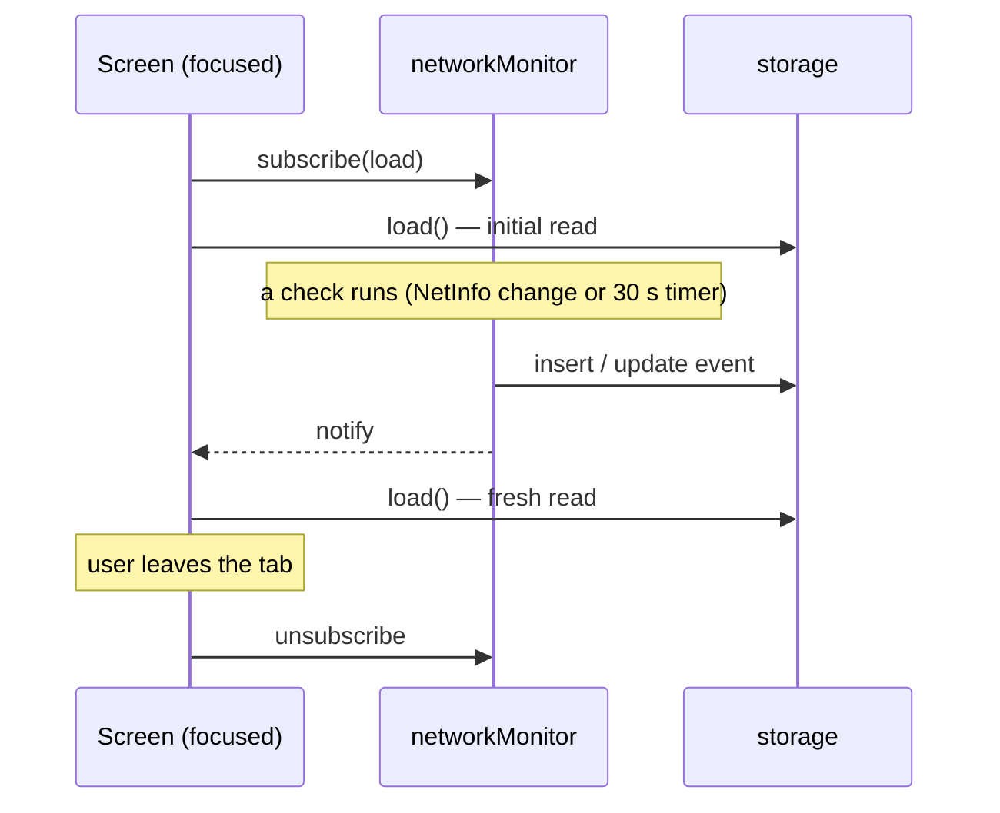
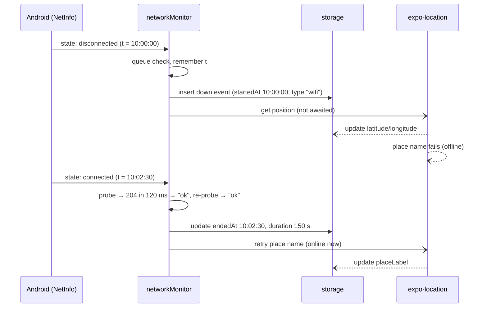
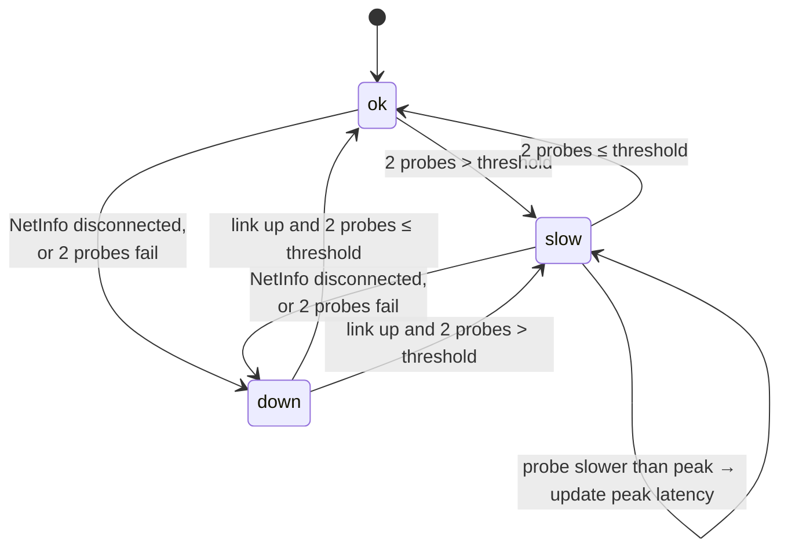

# Network Monitor

An Android app that keeps a log of **when your internet goes down** and **when it becomes slow**, with how long each problem lasted and where you were when it happened.

Everything runs on the phone. There is no server and no account: events are stored in a local SQLite database and can be exported as CSV.

| | |
|---|---|
| Platform | Android (Expo SDK 58, React Native 0.88, React 19) |
| Language | TypeScript |
| Storage | SQLite on the device (`expo-sqlite`) |
| Navigation | React Navigation 7 (bottom tabs + native stack) |

---

## Contents

1. [Features](#features)
2. [Getting started](#getting-started)
3. [Project structure](#project-structure)
4. [High-level design](#high-level-design)
5. [Mid-level design](#mid-level-design)
6. [Low-level design](#low-level-design)
7. [Testing](#testing)
8. [Known limitations](#known-limitations)

---

## Features

- **Outage detection.** Logs an event when the phone loses its connection, *and* when Wi-Fi stays connected but the internet behind it is dead (ISP down, router lost its uplink, captive login page).
- **Slowdown detection.** Measures latency every 30 seconds and logs a "slow" event when it stays above a threshold you choose (default 1500 ms). Records the worst latency seen.
- **No false alarms from blips.** A single slow or failed request is re-checked before anything is logged.
- **Location.** Each event is tagged with GPS coordinates and, once the internet is back, a place name.
- **History.** Filter by outages or slowdowns, add a note to any event, delete events.
- **Dashboard.** Live status, latency, connection type, outage count, total downtime.
- **CSV export.** Share the full log to WhatsApp, Drive, email, etc.

---

## Getting started

### Prerequisites

- Node.js (current LTS)
- The **Expo Go** app on an Android phone (for development), or an Expo account (for building an APK)

### Run in development (Expo Go)

```bash
npm install
npm start
```

Scan the QR code in the terminal with Expo Go. The phone and the PC must be on the same Wi-Fi network. If they can't reach each other, use `npx expo start --tunnel`.

### Build an installable APK

The `preview` profile in [`eas.json`](eas.json) builds a standalone `.apk` in Expo's cloud:

```bash
npx eas-cli@latest login
npx eas-cli@latest build -p android --profile preview
```

When the build finishes, EAS prints a download link and QR code for the APK.

### Useful commands

| Command | What it does |
|---|---|
| `npm start` | Start the Metro dev server for Expo Go |
| `npm run check` | Run the monitor logic test (no phone needed) |
| `npx tsc --noEmit` | Type-check the project |
| `npx expo-doctor` | Check dependency and config health |

### Trying it out on a phone

| To test | Do this |
|---|---|
| An outage | Turn Airplane mode on for ~30 s, then off |
| ISP down | Unplug the router's internet cable, keep Wi-Fi on |
| A slowdown | Settings → set the slow threshold to `100` ms (set it back afterwards) |

---

## Project structure

```text
network-monitor/
├── App.tsx                      # Startup: permissions, start monitoring, mount navigation
├── index.ts                     # Expo entry point
├── app.json                     # Expo config: package name, permissions, plugins
├── eas.json                     # Cloud build profiles (preview = APK)
├── scripts/
│   └── check-monitor.js         # Logic test for the outage/slow state machine
└── src/
    ├── navigation/index.tsx     # Tab + stack navigators
    ├── screens/
    │   ├── DashboardScreen.tsx  # Live status, Start/Stop, summary stats
    │   ├── HistoryScreen.tsx    # Event list, filters, export, delete
    │   ├── EventDetailScreen.tsx# One event's details + note
    │   └── SettingsScreen.tsx   # Location toggle, threshold, data, about
    ├── services/
    │   ├── networkMonitor.ts    # Detection engine (the core of the app)
    │   └── storage.ts           # SQLite access: events, settings, stats
    ├── components/Card.tsx      # Card, SectionTitle, Stat UI pieces
    ├── theme/theme.ts           # Colors, spacing, radii, shadow
    ├── types/index.ts           # NetworkEvent, LiveStatus, AppSettings
    └── utils/format.ts          # Time/duration/status formatting
```

---

## High-level design

### System context

The app talks to three things outside itself, all on or through the phone. There is no backend.



### How it decides what's happening

Two independent signals are combined:

1. **Android's connectivity status** (via NetInfo). Fast and reliable for "the phone has no network at all", but it often keeps saying "connected" when Wi-Fi is up and the internet behind it is not.
2. **An active probe**: a small HTTPS request to `https://www.google.com/generate_204`, which normally answers instantly with HTTP 204 and no body. Its round-trip time is the latency. If it fails, times out, or returns anything other than 204 (e.g. a Wi-Fi login page), the internet is treated as down.

From these, the app is always in one of three states, and every change of state is written to the database:

| State | Meaning | Logged as |
|---|---|---|
| `ok` | Internet works and latency ≤ threshold | — (closes any open event) |
| `slow` | Internet works but latency > threshold | a `slow` event |
| `down` | No connection, or the probe can't get through | a `down` event |

### Key design decisions

| Decision | Why |
|---|---|
| All data on the device, no server | Works offline (the whole point is to log offline periods), no account, no privacy concerns. |
| Probe a 204 endpoint, not just trust Android | Android often reports Wi-Fi as "connected" during an ISP outage. The probe catches it. |
| Re-check before changing state | One slow or failed request is common on mobile networks. Requiring two agreeing results removes most false events. |
| Checks run strictly one at a time | Android can report the same change several times in a burst. A queue guarantees one change creates one event. |
| Event time = when the change was reported | Even if a check waits behind a slow probe, the event's start and end times stay accurate. |
| Location fetched after the event is saved | A GPS fix can take a long time. The event is logged instantly and coordinates are filled in later. |
| Unknown end times stay unknown | If monitoring stops or the app is killed during an outage, the end time is left empty rather than guessed. |

---

## Mid-level design

### Modules and their responsibilities



| Module | Responsibility | Talks to |
|---|---|---|
| `App.tsx` | On launch: load settings, ask for location permission once (if not yet decided), start the monitor if logging is enabled, render navigation. | storage, networkMonitor |
| `services/networkMonitor.ts` | Owns all detection logic. Listens to NetInfo, probes latency every 30 s, decides `ok`/`slow`/`down`, opens and closes events, attaches location. Notifies the UI on every change. | NetInfo, fetch, expo-location, storage |
| `services/storage.ts` | The only module that touches SQLite. Creates the schema on first use; CRUD for events; settings key/value; summary stats. | expo-sqlite |
| `screens/*` | Display state and forward user actions. Hold no detection logic. | networkMonitor, storage, format |
| `utils/format.ts` | Pure formatting: times, durations, status labels/colors, "Ongoing" vs "Unknown" duration text. | — |

### How the UI stays up to date

The monitor uses a tiny publish/subscribe pattern. Screens subscribe **while they are focused** and reload when notified:



### Flow: an outage from start to finish



### Screens

| Screen | Shows | User actions |
|---|---|---|
| **Monitor** (Dashboard) | Live status (Online / Slow / Offline), latency, connection type, last check time; totals, downtime, average slow latency, last outage | Start / Stop logging; pull down to re-check now |
| **History** | All events, newest first, with duration, peak latency, place | Filter All / Outages / Slow; tap to open; long-press to delete; Export CSV; Clear all |
| **Event detail** | Every field of one event; refreshes live while open | Write and save a note |
| **Settings** | Location toggle, slow threshold, data totals, app version | Toggle location (asks permission); edit threshold; clear history |

---

## Low-level design

### Data model

**Table `network_events`**

| Column | Type | Notes |
|---|---|---|
| `id` | INTEGER PK AUTOINCREMENT | |
| `status` | TEXT NOT NULL | `down` or `slow` |
| `started_at` | INTEGER NOT NULL | epoch ms; indexed |
| `ended_at` | INTEGER | null = ongoing, or end not observed |
| `duration_ms` | INTEGER | set when the event closes |
| `latency_ms` | INTEGER | slow events: worst latency seen; null for outages |
| `connection_type` | TEXT | `wifi`, `cellular`, …; for outages, the connection that was lost |
| `latitude`, `longitude` | REAL | filled in after the event is saved |
| `place_label` | TEXT | reverse-geocoded, e.g. "12, MG Road, Delhi" |
| `note` | TEXT | user's note |
| `created_at` | INTEGER NOT NULL | row insert time |

Indexes: `idx_ne_started (started_at)`, `idx_ne_status (status)`.

**Table `settings`** — key/value strings.

| Key | Type | Default | Valid range |
|---|---|---|---|
| `slowThresholdMs` | number | `1500` | 100 – 60000 (values below 100 fall back to default) |
| `monitoringEnabled` | boolean | `true` | Start/Stop on the Monitor tab |
| `captureLocation` | boolean | `true` | Settings toggle |

The database opens lazily: the first call to any storage function opens `network-monitor.db`, enables WAL mode and creates the tables if missing. If opening fails, the next call retries instead of reusing the failure.

### The detection state machine



Each transition **closes** the open event (if any) and **opens** a new one (unless the new state is `ok`).

### The check algorithm

Every check, whether triggered by NetInfo, the 30 s timer, or pull-to-refresh, runs this, one at a time:

```text
check(state, at):                       # at = time the trigger happened
    state     ← state or NetInfo.fetch()
    threshold ← settings.slowThresholdMs
    timeout   ← max(10 000 ms, 2 × threshold)
    linkUp    ← state.isConnected ≠ false and state.isInternetReachable ≠ false
    current   ← status of the open event, or "ok"

    if linkUp:
        latency ← probe(timeout)
        status  ← classify(latency)          # null → down, > threshold → slow, else ok
        if status ≠ current:                 # suspected change: confirm it
            latency ← probe(timeout)
            status  ← classify(latency)      # trust the second result
    else:
        latency ← null; status ← down        # Android says no network: no probe needed

    type ← state.type, or last known type if state.type = "none"
    live ← { status, type: state.type, latency, checkedAt: now }

    if monitoring is running:
        if status ≠ current:
            close open event at `at`
            if status ≠ ok: open new event at `at`
        else if status = slow and latency > peak:
            update the event's latency to the new peak

    notify subscribers
```

`null` for `isConnected` / `isInternetReachable` means "unknown", not "offline". The probe decides in that case.

### The probe

```text
probe(timeout):
    start a timer that aborts the request after `timeout`
    GET https://www.google.com/generate_204   (cache: no-store)
    return elapsed ms if status = 204, otherwise null
    on any error or abort: return null
```

The timeout matters: React Native's networking has no default timeout, so without it a request on a dead network could hang indefinitely and block every later check.

### Serialization and timing

- All checks go through a single promise chain (`queue`). A new check starts only after the previous one has finished, so two checks can never both see "no open event" and both open one.
- The timestamp `at` is taken when the check is **requested**, not when it runs. If a check waits behind a 10 s probe, the event still gets the right time.
- `stop()` is also queued, so it takes effect after any check already in flight.

### Monitor API (`networkMonitor`)

| Member | Description |
|---|---|
| `start()` | Subscribe to NetInfo (which immediately delivers the current state as the first check) and start the 30 s timer. No-op if already running. |
| `stop()` | Unsubscribe, stop the timer, forget the open event. The event's end time is left empty, because the outage didn't end; we stopped watching. |
| `setEnabled(on)` | Save `monitoringEnabled`, then `start()` or `stop()`. Used by the Start/Stop button. |
| `refresh()` | Queue one check now; resolves when it's done. Logs events only while running; always updates `live`. |
| `subscribe(cb)` | Call `cb` after every check / start / stop. Returns an unsubscribe function. |
| `live` | Latest result: `{ status, type, latencyMs, checkedAt }`. |
| `activeId` | Id of the open event, or `null`. Used to show "Ongoing" vs "Unknown". |
| `isRunning()` | Whether logging is on. |

### Location pipeline

Runs in the background after an event is inserted, so it never delays logging:

1. Skip if `captureLocation` is off, or foreground location permission isn't granted. The monitor only *checks* permission; asking happens on app launch or from Settings, while the app is visible.
2. Use the last known position if it's under 5 minutes old; otherwise request a fresh one (Balanced accuracy).
3. Save latitude/longitude to the event.
4. Reverse-geocode to a place name (`name, street, city, region`). During an outage this fails because it needs internet, so it is retried when the outage closes.

### Storage API (`storage.ts`)

| Function | Purpose |
|---|---|
| `getSettings()` / `saveSettings(patch)` | Read all settings with defaults / upsert changed keys |
| `insertEvent(e)` → id | Create an event |
| `updateEvent(id, patch)` | Update only the fields given (end, duration, latency, location, place, note) |
| `getEvent(id)` | One event, or `null` if deleted |
| `listEvents(status?, limit = 1000)` | Newest first, optional status filter; `limit = -1` returns all (used by export) |
| `deleteEvent(id)` / `clearAll()` | Remove one / all events |
| `getStats()` | Totals, outage and slow counts, total downtime, last outage time, average slow latency |

### CSV export

Columns: `id, status, started, ended, durationSec, peakLatencyMs, connection, latitude, longitude, place, note`. Times are in the phone's local format; every value is quoted.

The CSV is written to a file in the app's cache folder and shared with `expo-sharing`. Sharing the text directly would crash on large logs, because Android limits how much data can be passed between apps in one go (~1 MB).

### Edge cases handled

| Situation | Behavior |
|---|---|
| Android reports the same change twice | One event (checks are serialized) |
| One slow or failed request | Ignored; a second probe must agree |
| Wi-Fi connected, internet dead | Probe fails twice → `down`, tagged with `wifi` |
| Wi-Fi login (captive) page | Probe gets a non-204 response → `down` |
| Network goes down mid-probe | Probe aborts at the timeout instead of hanging |
| Monitoring stopped / app killed during an event | End time left empty; shown as "Unknown (monitoring was off)" |
| Location slow or unavailable | Event saved immediately; location filled in later or left empty |
| Place name lookup while offline | Retried when the outage ends |
| User deletes an event that's still open | Later updates to it are ignored |
| Threshold set to nonsense | Rejected outside 100–60000 ms; previous value kept |
| Typing a threshold then switching tabs | Keyboard is dismissed on leaving, which saves the value |
| Database fails to open | That call fails; the next call retries the open |

---

## Testing

```bash
npm run check
```

[`scripts/check-monitor.js`](scripts/check-monitor.js) loads the real `networkMonitor.ts` with simulated NetInfo, storage, location and network, and walks through:

- healthy start logs nothing
- Wi-Fi drop reported twice → exactly one outage, correct start time, tagged `wifi`, location captured
- reconnect → correct end time and duration; place name resolved after reconnecting
- one slow probe followed by a fast one → ignored
- sustained slowness → slow event, peak latency kept, closed on recovery
- ISP down while Wi-Fi stays connected → outage
- Stop during an outage → end time left unknown
- refresh while stopped → live status updates, nothing logged

The screens are not covered by automated tests; verify them on a device with the steps in [Trying it out on a phone](#trying-it-out-on-a-phone).

---

## Known limitations

- **Reliable only while the app is open.** When the app is in the background, Android pauses JavaScript timers, so the 30-second slowdown check stops. Outages reported by Android are still logged until the system closes the app. Continuous background logging would need an Android foreground service (a permanent notification), which is not implemented.
- **No location in the background.** The app requests location only while in use, so events detected in the background have no coordinates.
- **Depends on Google being reachable.** On networks that block `google.com`, every check looks like an outage. Change `PROBE_URL` in `networkMonitor.ts` for such networks.
- **Very short handovers are logged.** Switching between Wi-Fi and mobile data can produce outages of a second or two. They are real, but may look noisy.
